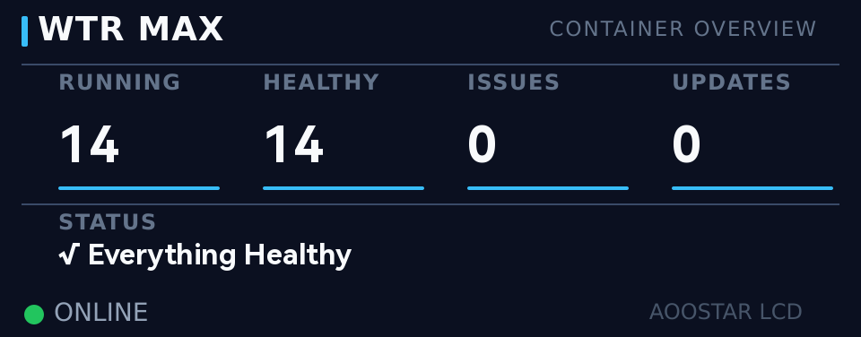

# AOOSTAR WTR MAX Dashboard

A custom front-panel dashboard for the **AOOSTAR WTR MAX** NAS. It replaces the factory LCD
screens with clean, distance-readable pages for system health, containers and storage, plus
an alert page that cuts into the rotation only when something is actually wrong.



## Pages

The 960 × 376 front LCD rotates through:

| Page | Shows |
|---|---|
| **System Overview** | CPU load and temperature, memory, pool usage, network rates, IP, date and time |
| **Container Overview** | Running / Healthy / Issues / Updates-available counts, plus a one-line status naming whatever needs attention |
| **Storage Overview** | One row per pool (capacity, read, write) and a per-disk grid with temperature and health |
| **Alerts** *(only when needed)* | Faulted or degraded pools, disk errors, over-temperature, container problems or a nearly full boot drive. Shown most severe first, and interleaved between the other pages until the condition clears |

## How it works

- Runs on [`asterctl`](https://github.com/zehnm/aoostar-rs), the open-source driver for
  AOOSTAR's panel, using the standard AOOSTAR-X panel format (`monitor.json` plus SVG/PNG
  backgrounds)
- Small shell scripts generate key/value sensor files once per second from `/proc`, hwmon, `zpool`
  and `docker ps` / `docker inspect`. Sensor files live on **tmpfs** so the
  one-second loop doesn't wear the SSDs
- **Container update detection** compares each running image's digest with its registry's
  current digest through the generic OCI distribution API (Docker Hub, GHCR, quay.io,
  lscr.io…). It runs once a day to stay well inside rate limits
- The **alert supervisor** debounces conditions and swaps the panel rotation at runtime
- Everything runs as **systemd** units (`scripts/install-systemd-units.sh`) and survives reboots
- Backgrounds are rendered by Python scripts (`scripts/render-*-bg.py`).
  `tools/pixel-probe` (Rust) measures exactly where `asterctl` draws text

### Upstream fix

While building this I found and patched a panel-rotation bug in `asterctl` 0.2.0. A rotation
list shorter than the panel list crashed the driver. The fix is in `bin/mianban-fix.patch`,
with background in `bin/README.md`.

## Setup

See **[docs/DETAILS.md](docs/DETAILS.md)** for full installation on TrueNAS SCALE,
persistence across reboots, USB-serial device pinning, the sensor data formats and the
design notes behind each page.

Short version:

```sh
scripts/generate-sensors.sh && cat sensors/dashboard.txt    # check the sensor output
sudo scripts/install-systemd-units.sh    # install the services (edit DASHBOARD_DIR first)
```

`asterctl` needs the panel font `HarmonyOS_Sans_SC_Bold.ttf` in `fonts/`. Copy it from the
stock AOOSTAR configuration; it is not redistributed here.
